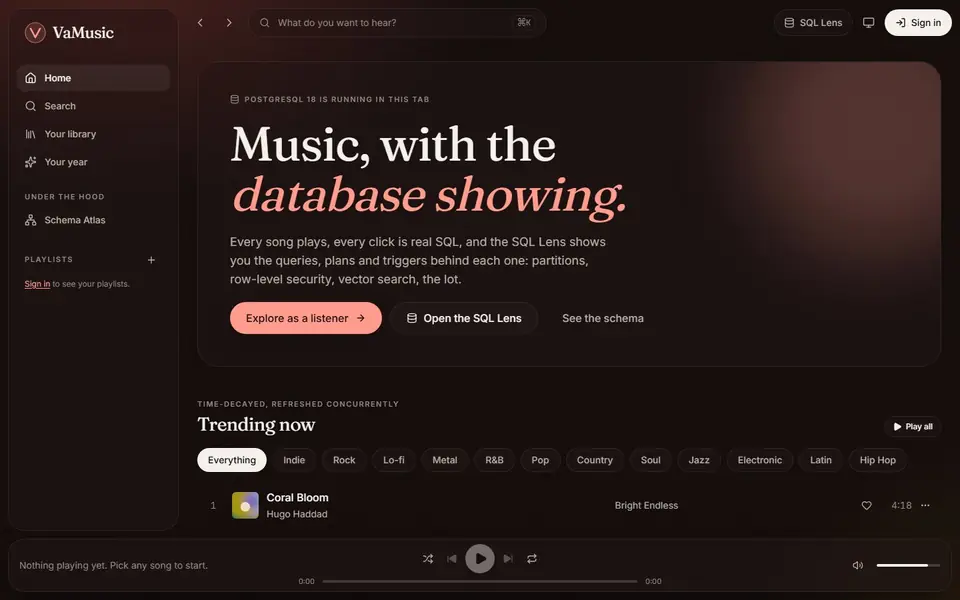
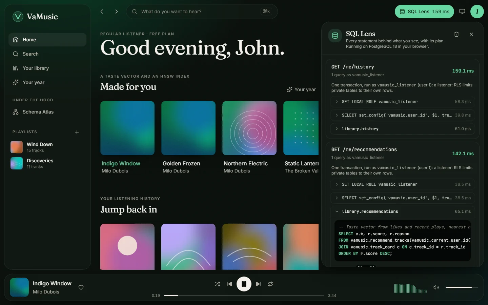
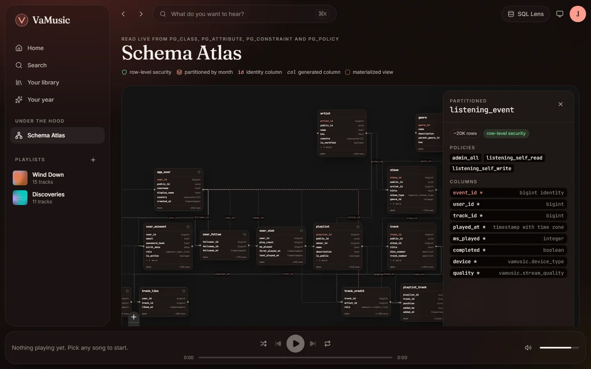
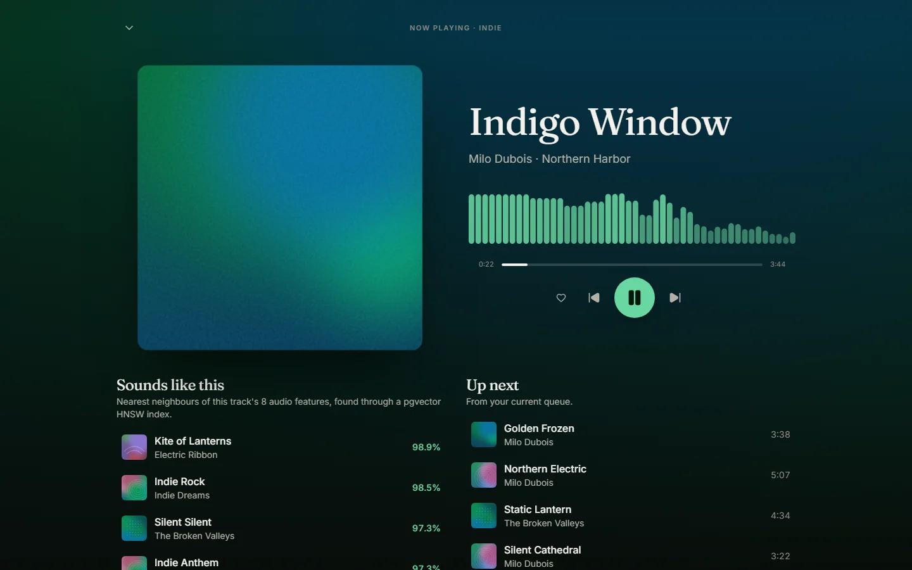
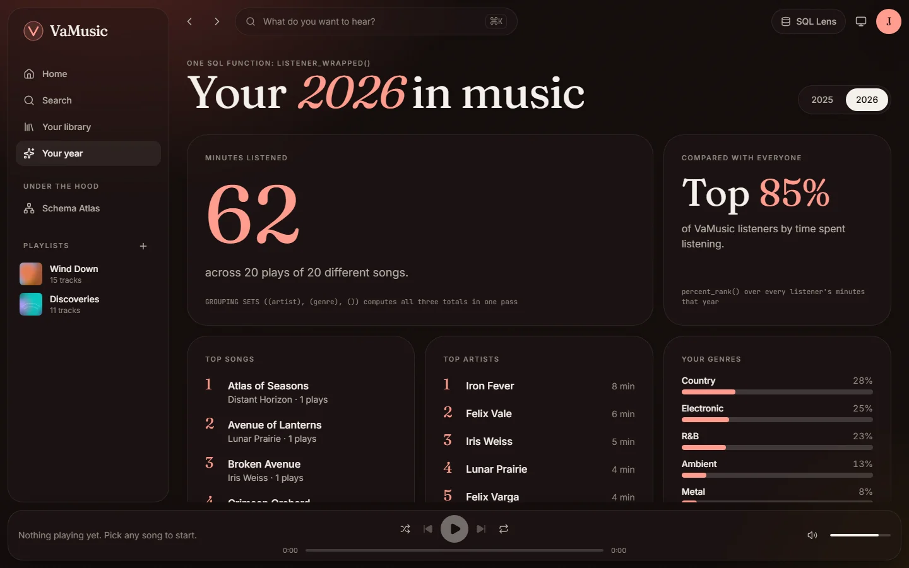

<div align="center">

<picture>
  <source media="(prefers-color-scheme: dark)" srcset="docs/assets/wordmark-dark.svg">
  
</picture>

### Music, with the database showing.

A music streaming app built database-first on PostgreSQL 18.<br>
Open any screen and see the exact SQL, plans and triggers behind it.

[](https://github.com/ManvGit17/tuple-beat/actions/workflows/ci.yml)
[](LICENSE)
[](CHANGELOG.md)


**[Live demo](https://manvgit17.github.io/tuple-beat/)** ·
**[Documentation](https://manvgit17.github.io/tuple-beat/docs/)** ·
[Quick start](#quick-start) ·
[Database design](docs/database.md)

<br>



</div>

## Why this exists

Most database course projects stop at a schema and a few `SELECT` statements behind a form. You
never find out whether the design survives real data, concurrent writes or a user who shouldn't
see someone else's playlists.

VaMusic started that way in 2025: a MySQL schema with Tkinter desktop apps, built as a database project. Version 2 rebuilds it around the problems a real streaming service has,
and solves them inside PostgreSQL rather than in application code: an event log that grows by
millions of rows, counters that can't afford a recount on every play, search that forgives typos,
"sounds like" recommendations, and per-listener privacy enforced by the database itself.

Then it makes that work visible. The web app's **SQL Lens** shows every statement a screen ran,
with parameters, timings, the plan tree and the triggers that fired. The **Schema Atlas** draws
the live schema from the system catalogs. And the hosted demo runs the real PostgreSQL 18, the
same migrations and the same SQL files, compiled to WebAssembly in your browser. Nothing to
install, no server, no account.

## What's inside

<table>
<tr>
<td width="50%"></td>
<td width="50%"></td>
</tr>
<tr>
<td><b>SQL Lens.</b> Every request's statements, parameters, timings, <code>EXPLAIN ANALYZE</code> plan and fired triggers, in the app or with <code>?lens=plan</code> on any API call.</td>
<td><b>Schema Atlas.</b> The schema drawn live from <code>pg_class</code>, <code>pg_constraint</code> and <code>pg_policy</code>: partitions, generated columns, RLS policies and row counts.</td>
</tr>
<tr>
<td></td>
<td></td>
</tr>
<tr>
<td><b>Sounds like this.</b> Nearest neighbours over 8-dimension audio-feature vectors through a pgvector HNSW index. Every track plays: music is generated in the browser from its features.</td>
<td><b>Your year.</b> A Wrapped-style recap from one SQL function: <code>GROUPING SETS</code>, gaps-and-islands streaks, <code>percent_rank</code> and <code>percentile_cont</code>.</td>
</tr>
</table>

| | |
| :-- | :-- |
| **Event store** | Listening history in a table range-partitioned by month, with a BRIN index on time. |
| **Counters without hot loops** | Play, like and listener counts kept by statement-level triggers over transition tables. Inserting 10,000 plays into a million-row history takes 0.19 s instead of 13.7 s ([benchmark](docs/database.md)). |
| **Analytics** | Time-decayed trending, daily plays and monthly listeners as materialized views refreshed `CONCURRENTLY`. |
| **Hybrid search** | Prefix full-text search and strict trigram matching on accent-folded text, fused with Reciprocal Rank Fusion: `midnite tran` finds "Midnight Train". |
| **Security in the database** | Least-privilege roles, row-level security on every per-listener table, `SECURITY DEFINER` functions with a pinned `search_path`, and a JSONB audit log that redacts secrets. |
| **PostgreSQL 18** | `uuidv7()` public ids, a virtual generated column, exclusion constraints over date ranges, deferrable constraints. |
| **One set of queries** | Every query lives in [`db/queries/`](db/queries/) and is run unchanged by the FastAPI server and by the in-browser database. |
| **Tested for real** | 175 tests against PostgreSQL 18 in containers, including attempts to read and write another listener's data that must fail; Playwright and axe-core tests for the web app. |

The reasoning behind each choice is in [docs/database.md](docs/database.md).

## Quick start

**In your browser, 0 seconds:** open the [live demo](https://manvgit17.github.io/tuple-beat/)
and choose **Explore as a listener**. The first visit builds the database locally, which takes a
few seconds; after that it loads from IndexedDB.

**With Docker, one command:**

```bash
git clone https://github.com/ManvGit17/tuple-beat.git vamusic
cd vamusic
docker compose up
```

That starts PostgreSQL 18, applies the migrations, loads a reproducible dataset (400 listeners,
about 2,000 tracks, 60,000 plays) and serves the API at <http://localhost:8000>, with interactive
docs at <http://localhost:8000/docs>. Every demo account uses the password `vamusic`: try
`john_doe`, or `admin` for the admin routes. If port 8000 is taken, set `API_PORT` (see
[.env.example](.env.example)).

```bash
curl "http://localhost:8000/api/search?q=midnite%20tran&lens=plan"
```

**The web app locally** (Node 24 and [uv](https://docs.astral.sh/uv/)):

```bash
cd web
npm install
npm run seed     # export the demo dataset
npm run dev      # http://localhost:5173, database runs in the browser
```

To point it at the API instead, run `VITE_API_URL=http://localhost:8000 npm run dev`.

## How it compares

Classic sample databases are good for learning SQL syntax. VaMusic is meant for learning how a
database carries an application.

| | Chinook | Pagila | VaMusic v1 (2025) | **VaMusic v2** |
| :-- | :--: | :--: | :--: | :--: |
| Domain | Music store | DVD rental | Music streaming | Music streaming |
| Working application | — | — | Tkinter desktop | Web app and REST API |
| Runs with no install | — | — | — | In the browser |
| Partitioned tables | — | ✓ | — | ✓ with BRIN |
| Full-text search | — | ✓ | — | ✓ fused with trigram |
| Vector similarity | — | — | — | ✓ pgvector HNSW |
| Row-level security | — | — | — | ✓ |
| Audit log | — | — | — | ✓ JSONB |
| Data | Fixed sample | Fixed sample | Hand-written rows | Seeded generator, up to 1M plays |
| Automated tests | — | — | — | 175 + browser tests |

## Repository layout

| Path | Contents |
| :-- | :-- |
| `db/migrations/` | The schema, as numbered SQL files applied once each |
| `db/queries/` | Every query the API runs, shared with the in-browser demo |
| `src/vamusic/` | API (FastAPI + psycopg 3), CLI, migration runner and data generator |
| `web/` | The web app (React 19, TypeScript, Tailwind CSS v4, PGlite) |
| `site/` | The documentation site |
| `tests/` | Database, API and generator tests against real PostgreSQL 18 |
| `legacy/` | The original MySQL + Tkinter project, with its crash bugs fixed |
| `docs/` | Audit, research, roadmap and design notes |

## Roadmap

Done: the PostgreSQL 18 core, the analytics and security work, hybrid search and vector
recommendations, the web app and the in-browser demo. Next, roughly in order:

- A `pg_stat_statements` view of the slowest queries in the admin workspace (Docker mode)
- A benchmark page in the docs comparing index choices on the same data
- "Describe a vibe" search with an embedding model running in the browser, opt-in and off by default
- Columnar analytics with pg_duckdb as a stretch goal (it isn't available in PGlite yet)

The full plan is in [docs/roadmap.md](docs/roadmap.md).

## Contributing

Issues and pull requests are welcome, from typo fixes to new SQL features. If you're new to the
project, [docs/good-first-issues.md](docs/good-first-issues.md) lists small, well-scoped tasks,
and [CONTRIBUTING.md](CONTRIBUTING.md) explains the setup, tests and commit style. Please read
the [code of conduct](CODE_OF_CONDUCT.md), and report security problems as described in
[SECURITY.md](SECURITY.md).

## Author

Version 2 is by ManvGit17. The original 2025 version was a DBMS mini project built by ManvGit17 and Lohith Anand. Released under the
[MIT License](LICENSE).
