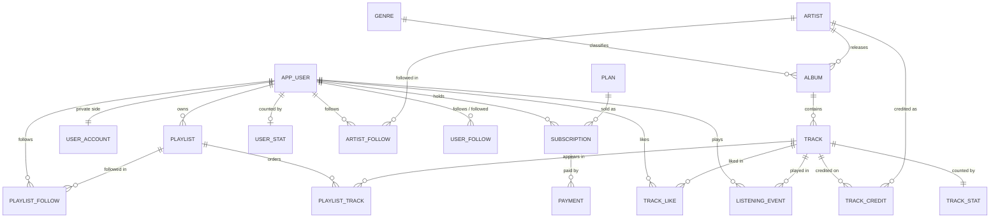

# Database design

VaMusic's logic lives in PostgreSQL 18. This page explains the schema and why each feature was
chosen. The SQL itself is in [`db/migrations/`](../db/migrations/), one numbered file per step.

| Migration | Contents |
| :-- | :-- |
| `0001_extensions_and_roles` | pgvector, pg_trgm, unaccent, btree_gist; request roles; `current_user_id()`, `fold()` |
| `0002_catalog` | genres, artists, albums, tracks, credits |
| `0003_listeners` | profiles, private accounts, plans, subscriptions, payments, likes, follows, playlists |
| `0004_listening_events` | partitioned event store and statement-level counters |
| `0005_analytics` | materialized-view rollups, trending, v1 functions and views, Wrapped |
| `0006_search_and_recommendations` | hybrid search, vector similarity, recommendations |
| `0007_security` | privileges, row-level security, `SECURITY DEFINER` functions |
| `0008_audit` | JSONB change log |
| `0009_cards` | `track_card` and `playlist_card`, display-ready views shared by the API and the web app |
| `0010_centred_similarity` | centred cosine similarity and an HNSW expression index |
| `0011_function_comments` | a `COMMENT ON` for every function, enforced by a test |
| `0012_brin_summaries` | `summarize_listening_events()`, run after bulk loads so the BRIN index is usable |

## Entity relationships



Derived data (materialized views): `daily_track_play`, `trending_track`,
`artist_monthly_listener` and `catalog_search`.

## Design decisions

### Keys: identity inside, uuidv7 outside

Every entity has a `bigint GENERATED ALWAYS AS IDENTITY` primary key for joins and a
`public_id uuid DEFAULT uuidv7()` that the API exposes. Sequential ids leak business volume and
invite enumeration; random uuidv4 keys fragment their B-tree with random page splits. PostgreSQL 18's
native `uuidv7()` is time-ordered, so the public-id index stays append-mostly.

### One table per fact

v1 stored likes in two tables (`UserLikedTrack`, `UserFavorites`) and follows in two
(`UserFollowArtist`, `UserFollowing`). The app wrote one and the analytics read the other, so a
like never moved the trending score. v2 has exactly one table for each.

### Public profile, private account

Users are split vertically. `app_user` (username, display name, country) is readable by anyone;
`user_account` (email, password hash, role) is visible only to its owner through row-level
security. Queries that only need a display name never touch a password hash.

### The event store

`listening_event` is range-partitioned by month (`listening_event_2026_10`, and so on), plus a
`DEFAULT` partition that should stay empty. This brings three benefits:

- queries with a time range touch only the relevant months (partition pruning, which is tested);
- old months can be detached or archived without a large `DELETE`;
- a **BRIN** index on `played_at` stays tiny (1.2 MB against 22 MB for a B-tree at a million
  rows), because rows arrive roughly in time order and it stores only a min/max per block range.

**Measured** with [`scripts/bench_brin.py`](../scripts/bench_brin.py) at a million plays, for a
range query ending at the busiest day (other indexes that end in `played_at` hidden):

| Range | Rows | BRIN, as loaded | BRIN, summarized | B-tree | No index |
| :-- | --: | --: | --: | --: | --: |
| 1 hour | 500 | 23.24 ms | **1.86 ms** | 2.55 ms | 16.70 ms |
| 1 day | 10,429 | 39.78 ms | 4.12 ms | **2.77 ms** | 22.90 ms |
| 7 days | 59,664 | 41.40 ms | 15.79 ms | **10.05 ms** | 25.64 ms |

A BRIN index created before a bulk load has no summaries for the loaded ranges, and a scan must
read every unsummarized range, which made it slower than no index. Migration 0012 adds
`summarize_listening_events()`, run by the seed loader and the browser demo after loading;
autovacuum covers live traffic. Summarized, BRIN is 19 times smaller than the B-tree, faster for
an hour of data and within about 1.5 times for a day or a week.

The partition key has to be part of the primary key, hence `PRIMARY KEY (event_id, played_at)`.
`ensure_listening_partitions()` creates months ahead of time, and `vamusic migrate` keeps a year of
partitions ready.

### Counters: statement-level triggers over transition tables

v1 ran row-level triggers on every listen. Two of them re-scanned the listening history to
recompute trending scores and monthly listeners, so the cost of one insert grew with the size of
the table.

v2 keeps running totals in `track_stat` and `user_stat`. They're updated by
`AFTER INSERT ... FOR EACH STATEMENT` triggers that read a transition table (`REFERENCING NEW
TABLE AS new_events`), aggregate it once, and apply one `UPDATE` per affected row. A bulk
insert or `COPY` of N events costs one aggregate, not N trigger calls. Anything defined over a
time window moved to materialized views.

**Measured** with [`scripts/bench_counters.py`](../scripts/bench_counters.py), which loads the
same data into two PostgreSQL 18 databases and installs a faithful port of the v1 triggers in one:

| Existing history | Operation | v1 row triggers | v2 statement triggers | Speed-up |
| :-- | :-- | --: | --: | --: |
| 60k events | insert 10,000 events | 5.52 s | 0.14 s | **38×** |
| 60k events | single insert, median | 1.30 ms | 0.79 ms | 1.7× |
| 1M events | insert 10,000 events | 13.72 s | 0.19 s | **73×** |
| 1M events | single insert, median | 1.89 ms | 0.85 ms | 2.2× |
| 1M events | single insert, p95 | 3.77 ms | 1.43 ms | 2.6× |

The v1 cost grows with history size and v2's doesn't, which is why the gap widens at 1M events.
Hot tracks still contend on their `track_stat` row under heavy concurrent writes. The usual next
step would be sharded counters or buffering through a queue; at this project's scale it isn't
needed.

### Analytics as materialized views, anchored to the data

`daily_track_play`, `trending_track` and `artist_monthly_listener` are materialized views with
unique indexes, so `refresh_analytics()` can use `REFRESH ... CONCURRENTLY` without blocking
readers. It reports how long each refresh took.

Trending uses exponentially decayed plays (half-life three days) plus distinct listeners and recent
likes, keeping v1's weights. Windows are measured from the newest event in the data, not from
`now()`. v1 used `NOW()`, so a week after the seed was loaded the trending list went blank. With
live traffic the two are identical; for demo data the anchor keeps the numbers meaningful.

### Hybrid search

`catalog_search` holds, per track, a weighted `tsvector` (title A, artists B, album C, genre D)
and a plain "haystack" string, both passed through `fold()` (lower case, accents removed with
`unaccent`). `search_tracks()` runs two rankings:

- **lexical**: every query word becomes a prefix term (`'mid':* & 'tra':*`), so search works as you
  type;
- **fuzzy**: `strict_word_similarity` from pg_trgm, with title matches weighted double, which
  survives typos.

The two lists are combined with **Reciprocal Rank Fusion** (score = Σ 1/(60 + rank)). RRF needs no
score normalisation between very different rankers. The function returns each list's rank too, so
you can see which one found a result.

A gotcha found while testing: plain `word_similarity` matches any fragment, so "midnite tran"
ranked "…bright kite, midnight kite…" above "Midnight Train". `strict_word_similarity` compares
whole-word extents and fixes it.

### Vector recommendations

Each track carries an 8-dimension `vector` of audio features (energy, valence, danceability,
acousticness, instrumentalness, speechiness, liveness, tempo). The generator scatters tracks
around per-genre centroids, so nearby vectors sound alike.

- Similarity is **centred cosine**: vectors are measured from the neutral point 0.5
  (`centred()`), because vectors with only non-negative coordinates can never point in opposite
  directions, which squeezed every neighbour's score towards 1. Migration 0010 indexes
  `centred(features)::vector(8)`; the cast is needed because pgvector requires a known
  dimension and PostgreSQL drops type modifiers from function results.
- `similar_tracks()` is a nearest-neighbour query on that **HNSW** expression index
  (`vector_cosine_ops`); a test checks that the plan uses it.
- `recommend_tracks()` averages the listener's liked and recently played tracks into a taste
  vector, then pulls nearest neighbours, skipping tracks they already like or played in the last
  30 days. Because that filter can discard many candidates, the function sets pgvector 0.8's
  `hnsw.iterative_scan = relaxed_order`, so the index keeps producing candidates instead of
  returning a short list. Listeners with no history get trending tracks instead.

### Security inside the database

| Role | Used for |
| :-- | :-- |
| `vamusic_app` | the API's login role; `NOINHERIT`, owns nothing, can only call login/sign-up |
| `vamusic_anon` | signed-out requests |
| `vamusic_listener` | signed-in requests |
| `vamusic_admin` | admin requests |

Each API request is one transaction that starts with

```sql
SET LOCAL ROLE vamusic_listener;
SELECT set_config('vamusic.user_id', '42', true);
```

Both settings are transaction-local, so nothing leaks to the next request that borrows the pooled
connection (tested). Row-level security policies then compare rows against `current_user_id()`:
listeners see only their own likes, follows, history, account and subscriptions; private playlists
are invisible to everyone else; writes use `WITH CHECK` so rows can't be created on someone
else's behalf. Column privileges stop a listener from changing their own `role`.

A few operations must see past one listener's rows (login, sign-up, global counters, follower
totals, rollups, Wrapped's percentile). They are `SECURITY DEFINER` functions, each with a pinned
`search_path` and `EXECUTE` granted only to the roles that need it.

The test suite found three real problems while this was being built:

1. `ALTER DEFAULT PRIVILEGES IN SCHEMA ... REVOKE EXECUTE ... FROM PUBLIC` does nothing, because
   per-schema defaults can only add privileges. Listeners could call `auth_lookup()` and read
   password hashes. Fixed by revoking after all functions exist and setting the global default.
2. Inside a `SECURITY DEFINER` trigger, `current_user` is the function owner, so the audit log
   recorded the wrong role. The role chosen by `SET ROLE` is read from `current_setting('role')`.
3. Functions without a pinned `search_path` broke for callers that didn't set one, and could be
   hijacked by callers that did (CVE-2018-1058). Every function in the schema now pins it.

### Audit log

`audit.capture()` is one generic trigger function attached to catalog tables and accounts. It
records the signed-in user, the request role, and, for updates, only the columns that changed, as
JSONB. Trigger arguments name columns to redact, so `password_hash` never reaches the log.

### Constraints that encode rules

- `subscription` has an **exclusion constraint** (`EXCLUDE USING gist (user_id WITH =,
  active_during WITH &&)`): a listener can't hold two subscriptions for overlapping dates.
  Back-to-back periods are fine because `daterange` upper bounds are exclusive.
- `playlist_track` positions are unique per playlist, checked `DEFERRABLE INITIALLY DEFERRED`, so
  `playlist_reorder()` can rewrite every position in one `UPDATE`.
- Usernames and emails are unique case-insensitively through expression indexes on `lower()`.
- `track.duration_seconds` is a PostgreSQL 18 **virtual** generated column: computed on read and
  never stored.

## From v1 to v2

| v1 (MySQL) | v2 (PostgreSQL 18) |
| :-- | :-- |
| `User` with password hash next to public fields | `app_user` + `user_account`, split by visibility |
| `UserLikedTrack` and `UserFavorites` | `track_like` |
| `UserFollowArtist` and `UserFollowing` | `artist_follow`, `user_follow` |
| `ListeningHistory`, one table | `listening_event`, monthly partitions + BRIN |
| `play_count`, `trending_score` columns updated by row triggers | `track_stat` via statement triggers; `trending_track` view |
| `GetUserRecommendations` (top genres) | `recommend_tracks` (taste vector + HNSW) |
| `SearchTracks` (`LIKE '%term%'`) | `search_tracks` (full text + trigram + RRF) |
| `GetUserTier`, `CalculateMonthlyRevenue` (both buggy) | `listener_tier`, `monthly_revenue` (fixed, tested) |
| `GetUserAnalytics` | `listener_wrapped` |
| `ArtistDashboard`, `TrackPerformance`, `PopularPlaylists` | `artist_dashboard`, `track_performance`, playlist API |
| No access control in the database | roles, RLS, definer functions, audit log |
