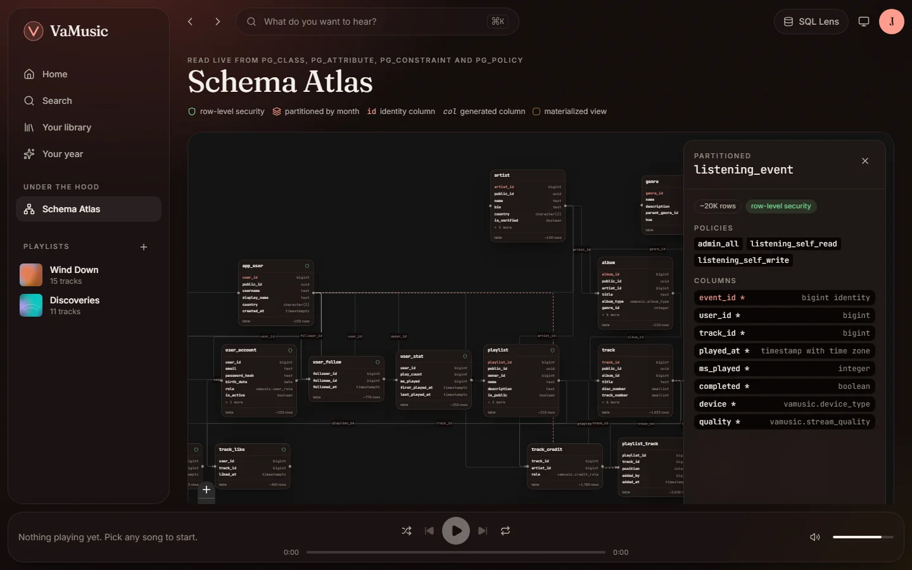

The schema is built by numbered SQL files in `db/migrations/`. The runner applies each one once,
in order, and records a checksum; it refuses to continue if an applied file changes, so merged
migrations are never edited.

| Migration | Contents |
| :-- | :-- |
| `0001_extensions_and_roles` | pgvector, pg_trgm, unaccent, btree_gist; request roles; `current_user_id()`, `fold()` |
| `0002_catalog` | Genres, artists, albums, tracks, credits |
| `0003_listeners` | Profiles, private accounts, plans, subscriptions, payments, likes, follows, playlists |
| `0004_listening_events` | The partitioned event store and statement-level counters |
| `0005_analytics` | Materialized-view rollups, trending, reports, Wrapped |
| `0006_search_and_recommendations` | Hybrid search, vector similarity, recommendations |
| `0007_security` | Privileges, row-level security, `SECURITY DEFINER` functions |
| `0008_audit` | The JSONB change log |
| `0009_cards` | `track_card` and `playlist_card`, display-ready views |
| `0010_centred_similarity` | Centred cosine similarity and its HNSW expression index |

The [Schema Atlas](https://manvgit17.github.io/Music-Streaming-Application-Database/atlas) in
the demo draws all of this live from the system catalogs.

## Main tables

- **Catalog:** `genre`, `artist`, `album`, `track`, and `track_credit` linking tracks to
  artists with a role: primary, featured, producer or composer.
- **Listeners:** `app_user` (public profile) and `user_account` (email, password hash, role);
  `plan`, `subscription` and `payment`.
- **Activity:** `listening_event`, `track_like`, `artist_follow`, `user_follow`.
- **Playlists:** `playlist`, `playlist_track` (ordered) and `playlist_follow`.
- **Derived:** `track_stat` and `user_stat` (running totals), and the materialized views
  `daily_track_play`, `trending_track`, `artist_monthly_listener` and `catalog_search`.

## Keys: identity inside, uuidv7 outside

Every entity has a `bigint GENERATED ALWAYS AS IDENTITY` primary key for joins and a
`public_id uuid DEFAULT uuidv7()` that the API exposes.

Sequential ids in URLs leak how big the service is and invite people to walk through them.
Random version 4 UUIDs fix that but scatter inserts across their B-tree index. PostgreSQL 18's
built-in `uuidv7()` starts with a timestamp, so new ids land at the end of the index like a
sequence, while still being impractical to guess.

## One table per fact

The 2025 version stored likes in two tables and follows in two. The app wrote one and the
analytics read the other, so a like never moved the trending score. Version 2 has exactly one
table for each fact.

## Public profile, private account

Users are split vertically. `app_user` holds what anyone may see: username, display name,
country. `user_account` holds email, password hash and role, and row-level security lets only
the owner read it. Queries that need a display name never touch a password hash.

## Constraints that encode rules

- **No overlapping subscriptions.** `subscription` has an exclusion constraint,
  `EXCLUDE USING gist (user_id WITH =, active_during WITH &&)`. Back-to-back periods are allowed
  because a `daterange`'s upper bound is exclusive.
- **Reordering in one statement.** `playlist_track` positions are unique per playlist, checked
  `DEFERRABLE INITIALLY DEFERRED`, so `playlist_reorder()` rewrites every position in a single
  `UPDATE` without tripping over itself.
- **Case-insensitive uniqueness.** Usernames and emails are unique through expression indexes on
  `lower()`.
- **Computed on read.** `track.duration_seconds` is a PostgreSQL 18 virtual generated column,
  derived from the stored milliseconds and never written to disk.
