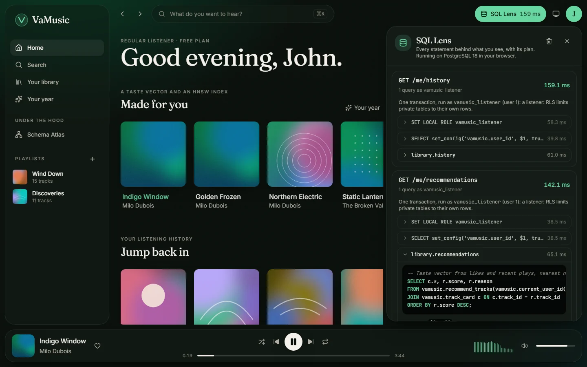

The SQL Lens records every statement a request runs. It works the same way in the web app and
in the API.



## In the web app

Click **SQL Lens** in the top bar. The drawer lists recent requests, newest first, each with:

- the **role** it ran as and the signed-in user id;
- every **statement**, with the name of the shared query it came from, its parameters, row
  count and time;
- for reads and writes, the **plan tree** from `EXPLAIN (ANALYZE, BUFFERS)`, with the time and
  rows at each node;
- the **triggers** that fired, such as the statement-level counters when you play a track.

Things worth trying:

- Search for `midnite tran` and compare the lexical and fuzzy ranks in the results.
- Open a track's now-playing view and look for the index scan on
  `track_features_centred_hnsw` in the "similar" query.
- Play a track and find `listening_event_count_insert` in the triggers.
- Sign in as `admin` and open the admin workspace: the role on each request changes from
  `vamusic_listener` to `vamusic_admin`.

## In the API

Add `lens` to any request:

| Parameter | What you get |
| :-- | :-- |
| `?lens=1` | Every statement with its parameters, timing and row count |
| `?lens=plan` | The same, plus the `EXPLAIN ANALYZE` plan, planning and execution time, and triggers |

The response is wrapped in an envelope:

```json
{
  "data": [ ... the normal response ... ],
  "lens": {
    "role": "vamusic_anon",
    "user_id": null,
    "total_ms": 3.42,
    "statements": [
      {
        "name": "catalog.search",
        "sql": "SELECT c.*, s.score, s.lexical_rank, s.fuzzy_rank FROM vamusic.search_tracks(...)",
        "params": ["midnite tran", "20"],
        "ms": 3.1,
        "rows": 20,
        "plan": { "Node Type": "Sort", "...": "..." },
        "triggers": [],
        "planning_ms": 0.4,
        "execution_ms": 2.6
      }
    ]
  }
}
```

## Writes are safe to trace

To get a plan, a statement has to run under `EXPLAIN ANALYZE`, which executes it. For writes the
Lens runs the `EXPLAIN` inside a savepoint that is always rolled back, then runs the statement
for real. A traced play is recorded exactly once.

## Turning it off

The Lens is on by default because this is a teaching project. Set `VAMUSIC_LENS_ENABLED=false`
on a deployment where plans and parameters shouldn't be visible to clients.
